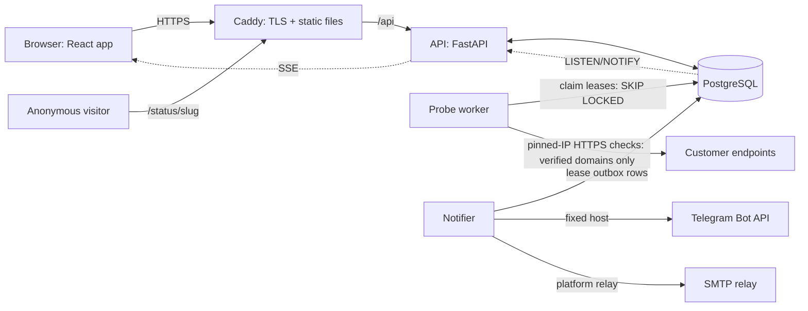

# SentinelOps

**Multi-tenant, agentless API monitoring and incident management.** Organizations verify their
domains, monitor public HTTP(S) endpoints on a schedule, get incidents opened and resolved
automatically, receive Telegram/email alerts, publish sanitized status pages and read uptime
reports, while a separate platform console administers the service without ever seeing
organization secrets.

Python 3.14 · FastAPI · SQLAlchemy 2 · PostgreSQL 17 · React 19 + TypeScript · Playwright

> Portfolio project built gate by gate (G0–G7) from an approved planning baseline
> ([docs/baseline-v1.0](docs/baseline-v1.0/README_DOCUMENTS.md)). Not deployed publicly.

## Highlights

| Area | What it does |
|---|---|
| Multi-tenancy | Organization context comes only from the URL and is re-checked on every request; other organizations get `404`. Composite organization-scoped foreign keys make cross-tenant links impossible in the database. |
| Roles | SYSTEM_ADMIN (platform plane, metadata only, TOTP MFA) and ORG_OWNER / ORG_ADMIN / ORG_MEMBER / VIEWER, enforced from a permission table that tests compare with [`PERMISSION_MATRIX.md`](docs/baseline-v1.0/PERMISSION_MATRIX.md). |
| SSRF-safe probes | Strict URL parsing, every DNS answer validated, connections pinned to the validated IP (SNI and certificate checks intact), no redirects or proxies, egress firewall in the worker container. |
| Incidents | Pure health state machine (3 failures open, 2 successes resolve), OUTAGE and TLS-expiry incidents, idempotent under duplicate or replayed worker results. |
| Notifications | Transactional outbox, at-least-once delivery with dedupe keys, retries with backoff, dispatch-time re-validation, per-channel rate limits, encrypted write-only Telegram credentials. |
| Analytics | Uptime with explicit coverage (missing or blocked checks are never counted as uptime), nearest-rank percentiles, hourly rollups, 30-day raw / 12-month rollup retention, CSV export. |
| Live updates | Server-sent events per organization with membership re-validation every 15 s. |
| Status pages | Opt-in, served only from allowlisted snapshots: no hosts, URLs, notes or members. |

## Architecture



One Python codebase runs as three processes (`api`, `worker`, `notifier`). PostgreSQL is the
only stateful dependency: job leases, the notification outbox and realtime fan-out all use it.
See [docs/ARCHITECTURE.md](docs/ARCHITECTURE.md) for module boundaries, data flow and the
security model.

## Quick start (local)

Requirements: Docker, [uv](https://docs.astral.sh/uv/), Node.js 24.

```bash
cp .env.example .env     # set POSTGRES_PASSWORD and SENTINELOPS_SECRET_KEYS (instructions inside)
docker compose up --build             # API http://127.0.0.1:8000, web http://127.0.0.1:5173
docker compose run --rm migrate       # apply migrations (manual by design)
docker compose run --rm api sentinelops bootstrap-system-admin --email you@example.test
docker compose --profile workers up   # optional: probe worker + notifier (mail goes to Mailpit)
```

The bootstrap prints a single-use activation link; there are no default accounts or passwords.
Fictional demo data is available for a separate, empty `*_demo` database:
[docs/DEMO.md](docs/DEMO.md).

## Tests and CI

```bash
cd apps/api && uv sync && uv run ruff check . && uv run pyright && uv run lint-imports && uv run pytest
cd apps/web && npm ci && npm run lint && npm run typecheck && npm test && npm run build
# Integration and browser tests need a disposable local database named exactly sentinelops_test:
SENTINELOPS_TEST_DATABASE_URL=postgresql+asyncpg://postgres:<pw>@127.0.0.1:<port>/sentinelops_test uv run pytest
cd apps/web && npx playwright install chromium && SENTINELOPS_TEST_DATABASE_URL=... npm run e2e
```

GitHub Actions runs lint, strict typing, import boundaries, unit + integration tests with
migration round-trips, frontend tests and build, Playwright (desktop and mobile Chromium) against a
disposable PostgreSQL, image builds and dependency audits. The test harness refuses any database
other than a local `sentinelops_test`, and every external system is faked.

## Documentation

| Document | Contents |
|---|---|
| [ARCHITECTURE.md](docs/ARCHITECTURE.md) | Processes, modules, data model, request and job flows |
| [SECURITY.md](docs/SECURITY.md) | Tenant isolation, SSRF, secrets, MFA, audit, dependency audit triage |
| [ENVIRONMENT.md](docs/ENVIRONMENT.md) | Every configuration variable |
| [operations/RUNBOOK.md](docs/operations/RUNBOOK.md) | Deployment, proxy/HTTPS, migrations, backups, workers, recovery |
| [DEMO.md](docs/DEMO.md) | Fictional demo data and a guided walkthrough |
| [RELEASE_CHECKLIST.md](docs/RELEASE_CHECKLIST.md) | Gate-closing and pre-deployment checklist, known limitations |
| [baseline-v1.0/](docs/baseline-v1.0/README_DOCUMENTS.md) | Requirements, architecture, database design, permission matrix, decisions |
