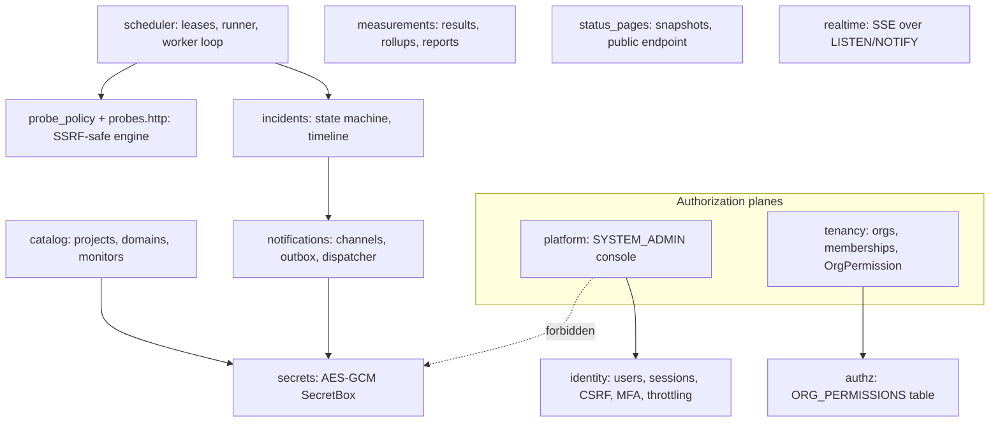
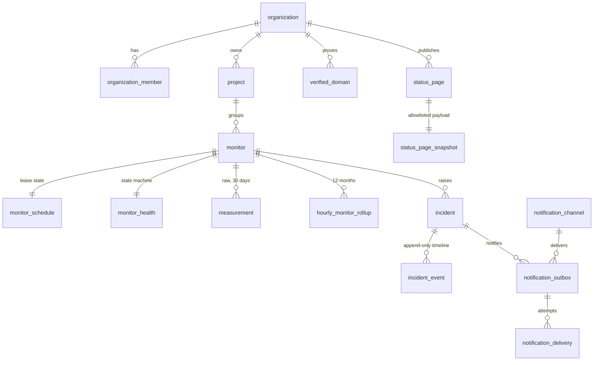

# Architecture overview

A summary of the implemented system. The normative design is
[baseline-v1.0/02_TECHNICAL_ARCHITECTURE.md](baseline-v1.0/02_TECHNICAL_ARCHITECTURE.md) and
[03_DATABASE_DESIGN.md](baseline-v1.0/03_DATABASE_DESIGN.md); implementation choices are recorded
as IC-01…IC-31 in [ARCHITECTURE_DECISIONS.md](baseline-v1.0/ARCHITECTURE_DECISIONS.md).

## Processes

| Process | Entry point | Responsibility |
|---|---|---|
| `api` | `uvicorn sentinelops.api.app:create_app` | REST API, sessions/CSRF, SSE, public status endpoint |
| `worker` | `python -m sentinelops.worker` | Claims due monitors, runs SSRF-safe probes, records results, health/incident transitions, rollups, retention, staleness, status snapshots |
| `notifier` | `python -m sentinelops.notifier` | Leases outbox rows, re-validates, delivers via Telegram / SMTP relay, records delivery history |
| `migrate` | `alembic upgrade head` | Manual only; never automatic |

## Modules (`apps/api/src/sentinelops`)

Import boundaries are enforced by import-linter: the platform plane can never import
`sentinelops.secrets` (ADR-005), and domain modules never import process entrypoints.

## Data model (ownership chain)

Every tenant table carries `organization_id`; parents have `UNIQUE(organization_id, id)` and
children reference `(organization_id, parent_id)`, so a row can never point into another
organization. The app connects as a least-privilege role (no DDL; append-only tables have no
UPDATE/DELETE grant).

## Check lifecycle

1. **Claim:** `FOR UPDATE SKIP LOCKED` over due schedules of ACTIVE monitors in ACTIVE
   organizations; each claim gets a lease and job ID; domain coverage is re-checked.
2. **Probe** (no transaction open): parse URL → resolve → validate every A/AAAA answer → connect to
   the validated IP with original Host/SNI → GET/HEAD, no redirects → classify PASS / SLOW / FAIL /
   BLOCKED / INCONCLUSIVE.
3. **Complete** (one transaction): verify job ID and generation → insert the measurement
   idempotently → for scheduled conclusive results apply the health state machine, open/resolve
   incidents, append timeline events, enqueue outbox rows, `pg_notify` → advance the schedule.
4. **Notify:** the notifier leases outbox rows, re-validates (org active, channel enabled,
   recipients still members, notice not superseded), sends, records results, retries with backoff.

## Realtime and reporting

- `pg_notify` inside the committing transaction → one LISTEN connection per API process →
  per-organization SSE subscribers (bounded queues, `resync` on overflow or reconnect).
- Reports use one source per hour: the rollup if the hour is fully inside the window, otherwise raw
  measurements. Uptime = available / conclusive; coverage = conclusive / expected slots.

## Platform plane

SYSTEM_ADMIN endpoints read only organization metadata and the aggregate views
`v_platform_org_summary`, `v_platform_usage_daily` and `v_platform_queue_health`. A SYSTEM_ADMIN
has no implicit membership: organization routes return `404` unless they are invited.
